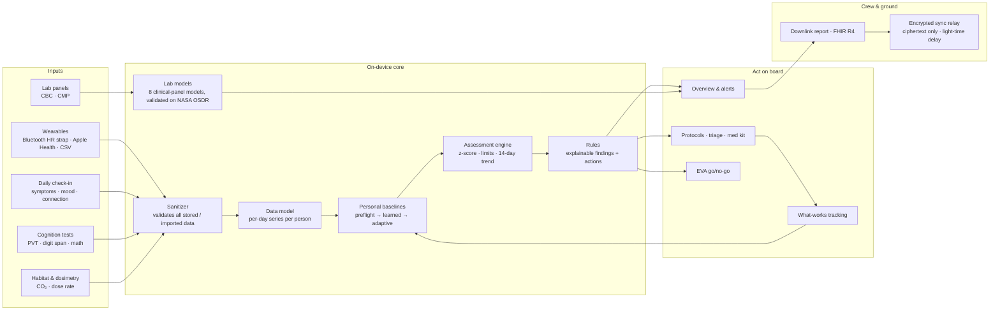
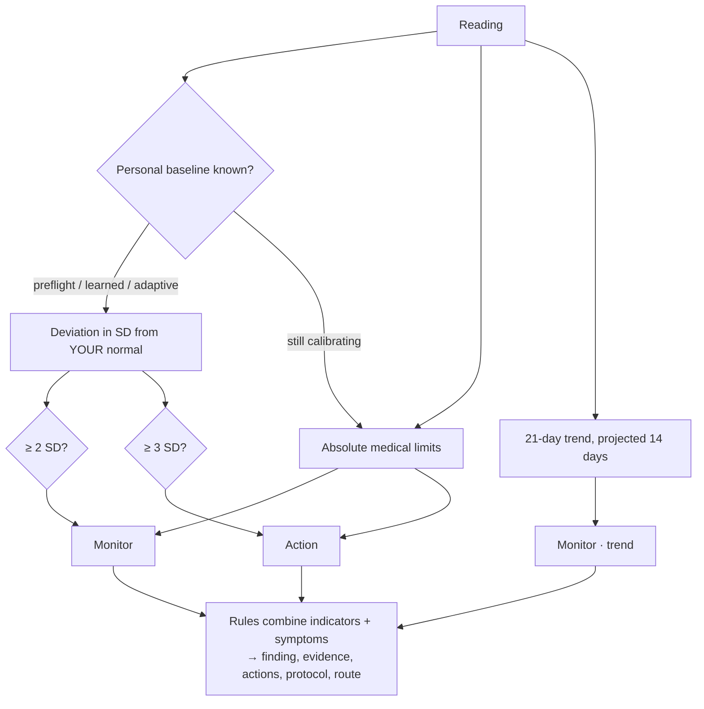

# HELIOS — architecture

HELIOS is a dependency-free, offline-first web app. Everything runs in the browser on the crew device; the only network paths are optional and user-initiated (encrypted sync, exported reports, browser voice recognition).

## System overview

## How an indicator is judged

Thresholds adjust with the alert sensitivity setting (Sensitive 1.5/2.5 SD, Standard 2/3, Conservative 2.5/3.5).

## Code map

| Path | Role |
|---|---|
| `js/data.js` | Mission, crew, the 24 indicators, deterministic simulator, personal series builder |
| `js/engine.js` | Indicator assessment, personal baselines, rules, readiness |
| `js/sanitize.js` | Bounds and validates every stored, restored or synced record |
| `js/vault.js` | Optional AES-256-GCM encryption at rest (PBKDF2 from the PIN) |
| `js/app.js` | Shell, core views, theme, lock screen, feature API (`H.app`) and event bus (`H.bus`) |
| `js/features/*.js` | 18 feature modules, each self-registering (replay, EVA, live sensor, labs, triage, …) |
| `tools/evaluate.js` | Leave-one-crew-out and nested evaluation on NASA OSDR data; exports `js/lab-model.js` |
| `tools/sync-server.js` | Ciphertext-only sync relay with optional light-time delay |
| `tools/a11y-audit.js` | In-page WCAG checks |
| `test/*.test.js` | 33 Node tests (`npm test`) |

## Data and validation

- **Real data:** SpaceX Inspiration4 crew blood panels (NASA OSDR OSD-569, OSD-575), with 4 crew and 7 draws each.
  - The lab models are scored leave-one-crew-out.
  - Ensemble AUROC: 0.85.
  - Nested-search estimate: 0.68.
  - Details are on the Model validation page.
- **Simulated data:** the demo mission's daily physiology, because no open in-flight astronaut wearable data exists. The mission replay shows how early the engine flags problems on this scenario. It demonstrates the method, not clinical performance.
- **Live data:** the Bluetooth sensor reads real heart rate and RR intervals through the standard Heart Rate profile and computes RMSSD on the device.

## Privacy and safety by design

- **On the device:** no accounts, no analytics, and no data leaves the device by default.
- **Encrypted at rest:** optional, with a PIN; wrong attempts are rate-limited across reloads.
- **Encrypted sync:** the passphrase is held in memory only, the channel ID is slow-derived, and a crewmate's record is never merged into yours.
- **Private by choice:** behavioural answers you mark private, and the private journal, never reach the medical officer's view, reports or FHIR.
- **Urgent findings:** a sticky alert on every screen, linked to triage.
- **Terms:** Terms & Conditions are accepted on first run. They say clearly that HELIOS is not a medical device.
