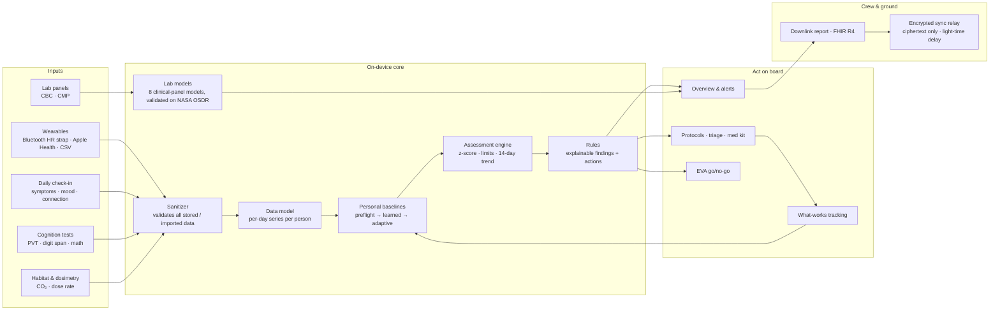
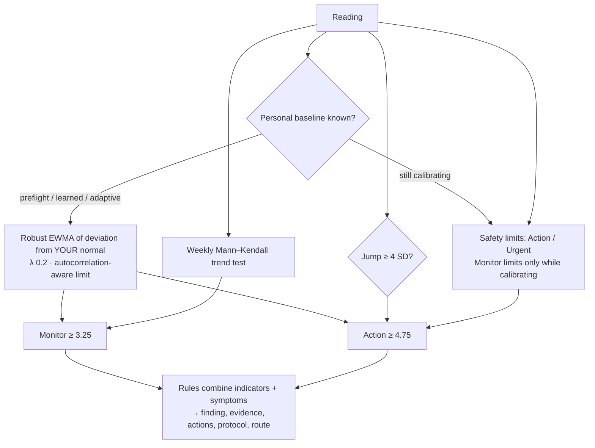

# HELIOS — architecture

HELIOS is a dependency-free, offline-first web app. Everything runs in the browser on the crew device; the only network paths are optional and user-initiated (encrypted sync, exported reports, browser voice recognition).

## System overview

## How an indicator is judged

### Weekly trend system (separate)

`js/weekly.js` runs independently of the daily engine, using the same personal baselines.

1. Daily readings are averaged per mission week. A week needs at least 3 readings for daily indicators.
2. The last 8 complete weeks are tested with:
   - **Mann–Kendall** (non-parametric) for a consistent trend, at p < 0.01 because about 24 indicators are tested
   - **Sen's slope** for the rate per week and the weeks until a limit is reached
   - a **CUSUM change-point estimate** of the week a confirmed drift began. It doesn't raise alerts: on the benchmark it latched onto the small error any estimated baseline has.
3. Expected in-flight trends (bone density) are removed first, and cumulative totals aren't trend-tested.

Since detector v2, the daily detector also uses these weekly tests (see below), so any slow drift they confirm raises an alert. On their own they caught the commander's slow resting-heart-rate rise on day 112.

Detector v3 was chosen on a randomized benchmark (`tools/benchmark.js`) and confirmed on held-out simulated people: 95.2 % detection with 2.7 false alarms per person-month and 3.1 % time in false alarm, against 94.8 %, 10.0 and 10.3 % for v1. On 16 real people over ~4 months (PMData), alerts fell 72 % and time in alert fell from 35.6 % to 6.3 %. The alert sensitivity setting moves the EWMA alert level (2.75 / 3.25 / 3.75). Sparse indicators (weekly labs, scans) keep the v1 2/3-SD rules; Conservative uses confirm-twice. Pattern findings combine related measurements when none has alarmed alone. Exercise thresholds are prescription targets, not safety limits.

## Code map

| Path | Role |
|---|---|
| `js/data.js` | Mission, crew, the 24 indicators, deterministic simulator, personal series builder |
| `js/engine.js` | Indicator assessment, personal baselines, rules, readiness |
| `js/weekly.js` | Separate multi-week trend detection (Mann–Kendall, Sen's slope, CUSUM) |
| `js/sanitize.js` | Bounds and validates every stored, restored or synced record |
| `js/vault.js` | Optional AES-256-GCM encryption at rest (PBKDF2 from the PIN) |
| `js/app.js` | Shell, core views, theme, lock screen, feature API (`H.app`) and event bus (`H.bus`) |
| `js/features/*.js` | 19 feature modules, each self-registering (replay, EVA, live sensor, labs, triage, …) |
| `tools/evaluate.js` | Leave-one-crew-out and nested evaluation on NASA OSDR data; exports `js/lab-model.js` |
| `tools/sync-server.js` | Ciphertext-only sync relay with optional light-time delay |
| `tools/a11y-audit.js` | In-page WCAG checks |
| `test/*.test.js` | 59 Node tests (`npm test`) |

## Data and validation

- **Real data:** SpaceX Inspiration4 crew blood panels (NASA OSDR OSD-569, OSD-575), with 4 crew and 7 draws each.
  - The lab models are scored leave-one-crew-out.
  - Ensemble AUROC: 0.85.
  - Nested-search estimate: 0.68.
  - Details are on the Model validation page.
- **Simulated data:** the demo mission's daily physiology, because no open in-flight astronaut wearable data exists. The mission replay shows how early the engine flags problems on this scenario. It demonstrates the method, not clinical performance.
- **Live data:** the Bluetooth sensor reads real heart rate and RR intervals through the standard Heart Rate profile and computes RMSSD on the device. It was validated on PhysioNet MMASH real recordings: r = 0.98 against a reference HRV computation, with noisy recordings flagged rather than reported.

## Privacy and safety by design

- **On the device:** no accounts, no analytics, and no data leaves the device by default.
- **Encrypted at rest:** optional, with a PIN; wrong attempts are rate-limited across reloads.
- **Encrypted sync:** the passphrase is held in memory only, the channel ID is slow-derived, and a crewmate's record is never merged into yours.
- **Private by choice:** behavioural answers you mark private, and the private journal, never reach the medical officer's view, reports or FHIR.
- **Urgent findings:** a sticky alert on every screen, linked to triage.
- **Terms:** Terms & Conditions are accepted on first run. They say clearly that HELIOS is not a medical device.
